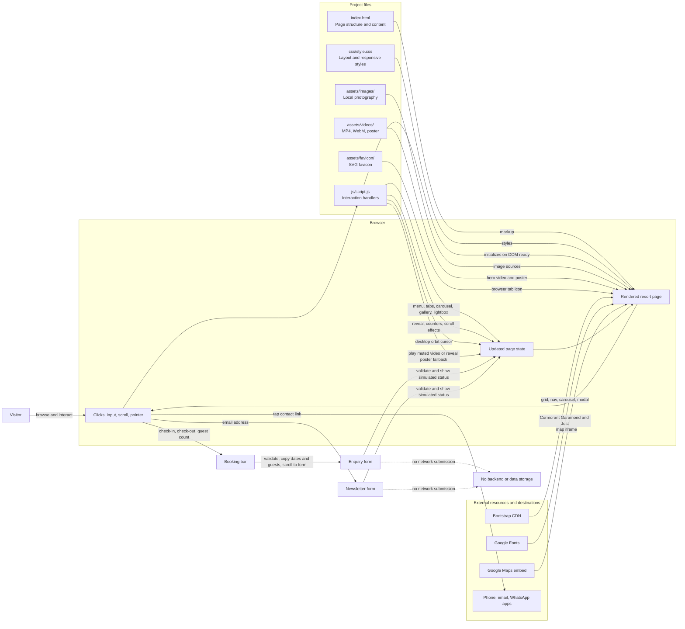

# Serein Sands data flow

This diagram shows how the static page, local assets, browser events, and page interactions fit together. The site has no application server or database; booking and newsletter forms provide client-side feedback only.

